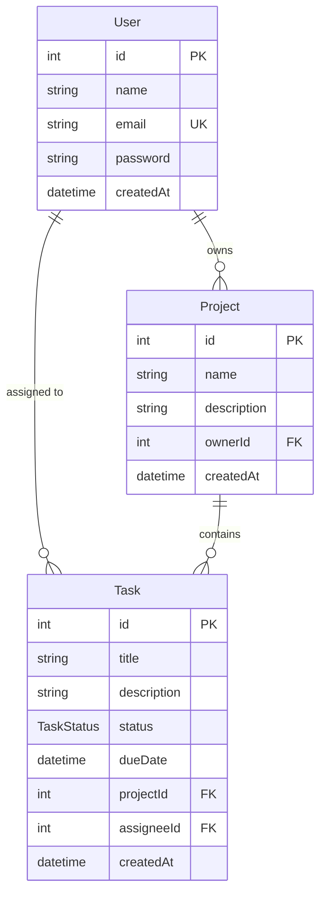

<div align="center">

# 📌 Task Management REST API

A modern, production-grade RESTful API built with **NestJS**, **Prisma ORM**, and **PostgreSQL**, fully containerized with **Docker** and managed effortlessly via a **Makefile**.

[](https://nestjs.com/)
[](https://www.typescriptlang.org/)
[](https://www.prisma.io/)
[](https://www.postgresql.org/)
[](https://www.docker.com/)

<p align="center">
  <b>Organize projects • Assign team members • Track task lifecycles • Enforce JWT security</b>
</p>

</div>

---

## 📖 Overview

This API is designed for team and project management (inspired by Trello and Jira). It allows companies to manage their workforce, structure work into projects, track tasks with deadlines, and control statuses across customizable workflows—all secured behind strict JWT authentication guards.

### ✨ Key Features

- 🔐 **Stateless Authentication:** Secure registration and login using salted `bcrypt` password hashing and signed JSON Web Tokens (JWT).
- 🛡️ **Global Route Guards:** Application-wide `JwtAuthGuard` enforced via `APP_GUARD`, with a custom `@Public()` decorator for public auth routes.
- 👥 **User Management:** Full CRUD operations with email uniqueness constraints.
- 📁 **Project Organization:** One-to-many relationship linking projects to employee owners.
- 📋 **Task Tracking & Kanban:** Nested REST endpoints (`/projects/:id/tasks`), multi-parent relationships, deadline dates (`dueDate`), and strict `TaskStatus` Enum validation (`TODO`, `IN_PROGRESS`, `DONE`).
- 🔎 **Query Filtering:** Instant status filtering with type-safe `ParseEnumPipe` query parameters.
- 🐳 **Containerized & Automated:** One-command deployment and lifecycle management powered by **Docker Compose** and a root **Makefile**.

---

## 🛠️ Tech Stack & Architecture

- **Backend Framework:** [NestJS](https://nestjs.com/) (Node.js ESM)
- **Database Engine:** [PostgreSQL 17 Alpine](https://www.postgresql.org/)
- **Data Layer:** [Prisma ORM](https://www.prisma.io/) with `@prisma/adapter-pg`
- **Validation Layer:** `class-validator` & `class-transformer`
- **Security:** `@nestjs/jwt`, `bcrypt`
- **Testing:** Integration bash test suite (`testApi.sh`), Vitest

### Request Lifecycle

```
[ Client Request ]
       │
       ▼
[ Global JwtAuthGuard ] ── (Is route @Public()? No token? ──► 401 Unauthorized)
       │
       ▼
[ ValidationPipe (Whitelist & Transform) ] ── (Invalid payload? ──► 400 Bad Request)
       │
       ▼
[ Controller ]  (Extracts @Param, @Body, @Query with Parse Pipes)
       │
       ▼
[ Service ]     (Business logic & Foreign-Key existence verification)
       │
       ▼
[ Prisma ORM ]  (Type-safe database queries)
       │
       ▼
[ PostgreSQL ]
```

---

## ⚡ Quickstart with Makefile

The project includes a root `Makefile` that handles the entire lifecycle of Docker containers and test workflows:

| Command | Action | Description |
|---|---|---|
| `make` (or `make up`) | **Build & Run** | Builds the Docker images and starts all services in the background |
| `make build` | **Build Images** | Builds backend and database Docker images |
| `make log` | **Follow Logs** | Streams live logs from all running containers |
| `make clean` | **Stop Services** | Stops and removes active containers and orphan containers |
| `make fclean` | **Full Reset** | Stops containers, deletes persistent volumes (`db/data`), and removes images |
| `make re` | **Restart Fresh** | Runs `fclean` followed by `make all` |
| `make test` | **Run Tests** | Runs the automated end-to-end integration test suite |

---

## 🚀 Step-by-Step Installation

### 1. Clone the Repository
```bash
git clone git@github.com:obbad-dev/task-managment-api.git
cd task-managment-api
```

### 2. Configure Environment Files

Create the base configuration files:

**`.env`** (Root Docker Compose config):
```env
POSTGRES_USER=oobbad
POSTGRES_PASSWORD=1234
POSTGRES_DB=nestDB
```

**`backend/.env`** (Backend application config):
```env
DATABASE_URL=postgresql://oobbad:1234@db:5432/nestDB
JWT_SECRET=super_secret_jwt_key_here
```

### 3. Launch the Stack
Simply run:
```bash
make
```

Both `backend-container` (Port `3000`) and `db-container` (Port `5432`) will compile, connect, and start in watch mode with hot reloading enabled.

---

## 🗄️ Database Schema



---

## 📡 API Reference & Examples

### 1. Authentication

#### Register a User
```http
POST /auth/register
Content-Type: application/json

{
  "name": "Sara Connor",
  "email": "sara@example.com",
  "password": "securepassword123"
}
```
**Response (201 Created):**
```json
{
  "id": 1,
  "name": "Sara Connor",
  "email": "sara@example.com",
  "createdAt": "2026-11-16T10:00:00.000Z"
}
```

#### Login & Receive JWT Token
```http
POST /auth/login
Content-Type: application/json

{
  "email": "sara@example.com",
  "password": "securepassword123"
}
```
**Response (200 OK):**
```json
{
  "access_token": "eyJhbGciOiJIUzI1NiIsInR5cCI6IkpXVCJ9..."
}
```

> **Note:** For all protected endpoints below, provide the token in the header:  
> `Authorization: Bearer <your_access_token>`

---

### 2. Projects Management

| Method | Endpoint | Description |
|---|---|---|
| `POST` | `/projects` | Create a new project |
| `GET` | `/projects` | List all projects (with owner details) |
| `GET` | `/projects/:id` | Get single project by ID |

#### Create Project Example
```http
POST /projects
Authorization: Bearer <token>
Content-Type: application/json

{
  "name": "E-Commerce Website",
  "description": "Building our modern online marketplace",
  "ownerId": 1
}
```

---

### 3. Tasks Management

| Method | Endpoint | Description |
|---|---|---|
| `POST` | `/projects/:id/tasks` | Create task under project `:id` |
| `GET` | `/projects/:id/tasks` | Get all tasks in project |
| `GET` | `/projects/:id/tasks?status=TODO` | Filter tasks by `TODO`, `IN_PROGRESS`, or `DONE` |
| `PATCH` | `/tasks/:id` | Update task status, deadline, or assignee |
| `DELETE` | `/tasks/:id` | Delete task by ID |

#### Create Task Example
```http
POST /projects/1/tasks
Authorization: Bearer <token>
Content-Type: application/json

{
  "title": "Build Auth API",
  "description": "Implement JWT and hashing with bcrypt",
  "status": "TODO",
  "dueDate": "2026-12-01T12:00:00.000Z",
  "assigneeId": 1
}
```

#### Update Task Status Example
```http
PATCH /tasks/1
Authorization: Bearer <token>
Content-Type: application/json

{
  "status": "IN_PROGRESS"
}
```

---

## 🧪 Automated Testing

Execute the complete end-to-end integration test suite using:

```bash
make test
```

The script automatically executes:
1. User registration (`POST /auth/register`)
2. Token generation (`POST /auth/login`)
3. Auth Guard rejection test without token (`401 Unauthorized`)
4. Project creation, retrieval, and relation check
5. Task creation under a project
6. Query filtering verification (`?status=TODO`)
7. Task status transition (`TODO` -> `DONE`)
8. Task deletion (`DELETE /tasks/:id`)

---

## 👨‍💻 Author

- **Oualid Obbad** - [@obbad-dev](https://github.com/obbad-dev)
